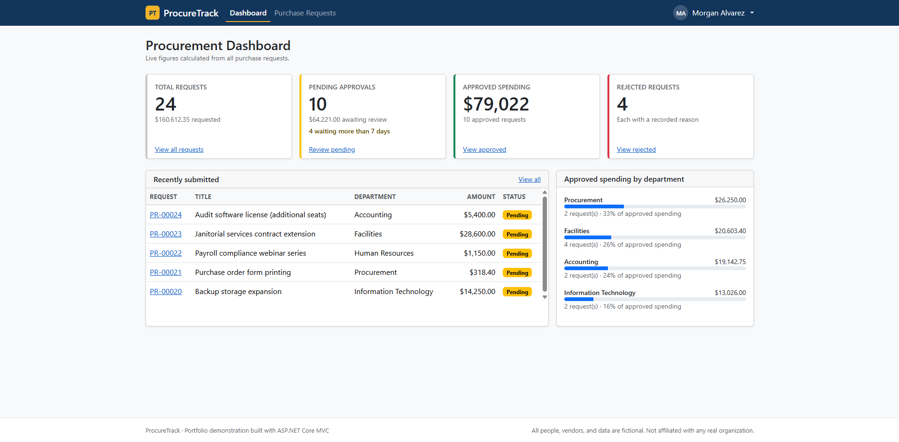
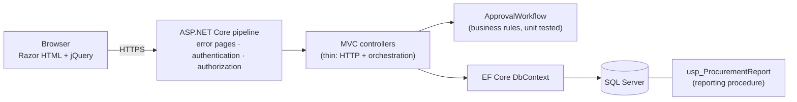
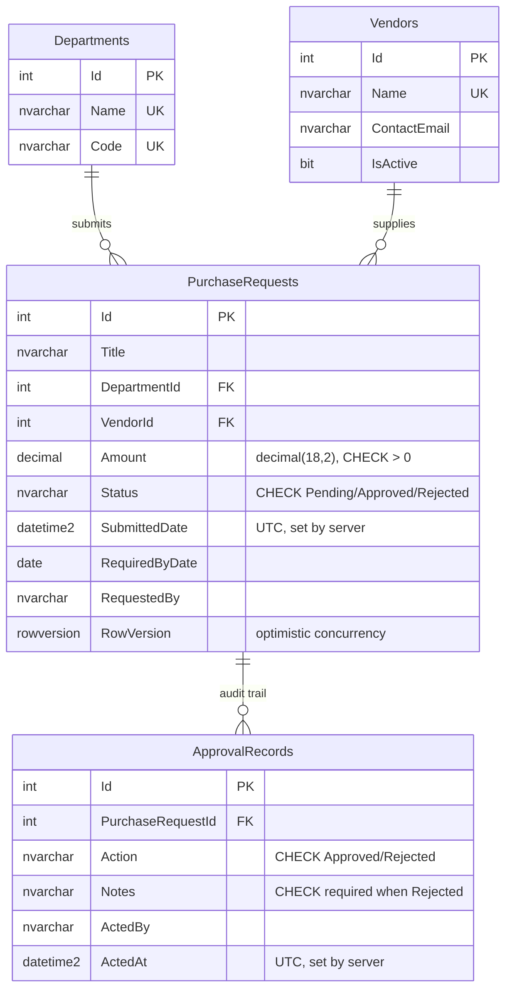

# ProcureTrack

A procurement request and approval system built with **C#, ASP.NET Core MVC (.NET 10), Entity Framework Core, SQL Server, and jQuery**, a portfolio project demonstrating enterprise business-application development on the Microsoft stack.

> **Disclaimer:** ProcureTrack is a portfolio demonstration. All people, departments, vendors, and data are fictional. It is not affiliated with any real organization.



## Contents

- [Purpose](#purpose)
- [Features](#features)
- [Technology](#technology)
- [Architecture](#architecture)
- [Data model](#data-model)
- [Getting started](#getting-started)
- [Demo users](#demo-users)
- [Running the tests](#running-the-tests)
- [Security](#security)
- [Reporting](#reporting)
- [Known limitations](#known-limitations)
- [Project documentation](#project-documentation)
- [Possible next steps](#possible-next-steps)

## Purpose

ProcureTrack models an internal business application of the kind that supports Accounting, Human Resources, Procurement, and Project Controls departments: employees submit purchase requests, approvers approve or reject them, and every decision is recorded in an audit trail.

The project demonstrates:

- Server-rendered **ASP.NET Core MVC** with Razor views, view models, and tag helpers
- **SQL Server** data modeling with keys, relationships, check constraints, indexes, and a reporting stored procedure
- **Entity Framework Core** migrations and parameterized LINQ queries
- **jQuery** for AJAX partial-page updates and client-side validation, built as progressive enhancement
- **Secure coding**: layered validation, antiforgery, role-based authorization, ownership checks, optimistic concurrency, and safe error handling
- **Automated testing** with xUnit unit tests and `WebApplicationFactory` integration tests
- **SDLC documentation**: user stories, storyboards, test plan, user guide, and deployment notes

## Features

**Dashboard**
- Total requests, pending approvals (with requests waiting more than 7 days), approved spending, and rejected requests, all calculated from the database
- Five most recently submitted requests
- Approved spending by department
- Each KPI card links to a pre-filtered request list

**Purchase requests**
- List with filters for search text, department, vendor, status, and submission date range
- Filters update the table in place via AJAX; the URL stays bookmarkable, and the page still works without JavaScript
- Details page with the full request and its approval history
- Create, edit, and delete with client-side and server-side validation
- Only the requester can edit or delete their own request, and only while it is Pending

**Approval workflow**
- Approvers approve or reject Pending requests; a rejection requires a reason
- Separation of duties: nobody can decide on their own request
- Every decision is stored as an append-only audit record (who, what, when, why)
- Confirmation dialog before a decision is saved
- Optimistic concurrency: if a request changes after an approver opens it, the decision is refused rather than applied to a version they never saw

**User experience**
- Responsive layout with status badges, empty states, loading and error states
- Accessible labels, keyboard navigation, skip link, live-region announcements for AJAX results, and a WCAG AA contrast fix verified with Lighthouse
- Friendly 400, 403, 404, and error pages that never expose technical details

## Technology

| Area | Technology |
|---|---|
| Language | C# 14 |
| Framework | ASP.NET Core MVC on .NET 10 (LTS) |
| Data access | Entity Framework Core 10 (SQL Server provider) |
| Database | SQL Server; developed on SQL Server Express LocalDB 2025 |
| UI | Razor views, HTML5, CSS, Bootstrap 5 |
| Client scripting | jQuery, jQuery Validation, jQuery Unobtrusive Validation |
| Authentication | ASP.NET Core cookie authentication (demo sign-in, see [Security](#security)) |
| Testing | xUnit, Microsoft.AspNetCore.Mvc.Testing |
| Tooling | .NET CLI, `dotnet-ef` (local tool), VS Code, SQL Server Management Studio, Git and GitHub |

No React, Angular, Vue, Node.js, or frontend build pipeline: the project deliberately uses the Microsoft stack directly.

## Architecture



**Design decisions**

- **Business rules in one class.** `ApprovalWorkflow` contains every approval rule and has no database or HTTP code, so each rule is unit tested directly. Controllers call it; they never change a request's status themselves.
- **View models for every form.** Forms bind to view models that omit `Status`, `SubmittedDate`, and `RequestedBy`, so those fields cannot be over-posted.
- **Three validation layers.** jQuery gives instant feedback; C# attributes and business-rule checks are authoritative; SQL Server check constraints are the final backstop.
- **Results, not exceptions, for rule violations.** Expected outcomes such as "this request is already approved" are returned as `WorkflowResult` values. Exceptions are reserved for unexpected failures.
- **`TimeProvider` for the clock**, so timestamps are testable.
- **Deny-by-default authorization.** A fallback policy requires sign-in on every endpoint unless it is explicitly marked anonymous.

**Repository layout**

```
procurement-tracker/
├── src/ProcureTrack.Web/
│   ├── Controllers/        HTTP handling (Home, PurchaseRequests, Account)
│   ├── Data/               DbContext and development seeder
│   ├── Migrations/         EF Core migrations, including the report procedure
│   ├── Models/             Entities and workflow enums
│   ├── Security/           Role names and demo users
│   ├── Services/           ApprovalWorkflow and WorkflowResult
│   ├── ViewModels/         Screen-specific models
│   ├── Views/              Razor views and partials
│   └── wwwroot/            CSS, jQuery scripts, client libraries
├── tests/ProcureTrack.Tests/
│   ├── ApprovalWorkflowTests.cs           unit tests
│   └── Integration/                       WebApplicationFactory tests
├── database/schema.sql     Full schema as T-SQL (generated from migrations)
├── reports/sql/            Readable copy of the reporting procedure
└── docs/                   User stories, test plan, user guide, deployment, screenshots
```

## Data model



**Constraints and indexes**

- `CK_PurchaseRequests_Amount_Positive`: amount must be greater than zero
- `CK_PurchaseRequests_Status` and `CK_ApprovalRecords_Action`: only valid status and action values
- `CK_ApprovalRecords_RejectionRequiresNotes`: a rejection must include non-blank notes. The check includes an explicit `IS NOT NULL`, because a CHECK constraint that evaluates to NULL passes in SQL Server.
- Unique indexes on department name, department code, and vendor name; indexes on `Status` and `(DepartmentId, SubmittedDate)` support the dashboard and filters
- Foreign keys use `ON DELETE RESTRICT`, so audit history can never be cascade-deleted

The complete schema is available as plain T-SQL in [`database/schema.sql`](database/schema.sql).

## Getting started

### Prerequisites

- Windows 10 or 11
- [.NET 10 SDK](https://dotnet.microsoft.com/download)
- SQL Server Express **LocalDB** (installed with Visual Studio, or via the SQL Server Express installer → *Download Media* → *LocalDB*)
- Optional: SQL Server Management Studio, to browse the database

### Run the application

```powershell
git clone https://github.com/c-saylor/procurement-tracker.git
cd procurement-tracker
dotnet dev-certs https --trust
dotnet run --project src/ProcureTrack.Web
```

Open the HTTPS address printed in the terminal (for example, `https://localhost:7xxx`) and choose a [demo user](#demo-users).

### Database initialization

In the Development environment, the application **creates the database, applies all migrations, and loads fictional sample data on first startup**. No manual database steps are required. The default connection string, in `appsettings.Development.json`, uses Windows authentication against `(localdb)\MSSQLLocalDB` and contains no credentials.

Useful commands (run `dotnet tool restore` once first to install the `dotnet-ef` tool):

| Task | Command |
|---|---|
| Apply migrations manually | `dotnet ef database update --project src/ProcureTrack.Web` |
| Reset to fresh sample data | `dotnet ef database drop --force --project src/ProcureTrack.Web`, then run the app |
| Regenerate the SQL script | `dotnet ef migrations script --project src/ProcureTrack.Web --output database/schema.sql` |

To use a different SQL Server instance, override the connection string with an environment variable or user secrets instead of editing committed files:

```powershell
$env:ConnectionStrings__ProcureTrack = "Server=localhost;Database=ProcureTrack;Trusted_Connection=True;TrustServerCertificate=True"
```

In production, migrations would be applied from a reviewed SQL script rather than at startup. See [docs/deployment.md](docs/deployment.md).

## Demo users

The sign-in page offers three fictional users. There are no passwords; see [Security](#security).

| User | Roles | Try this |
|---|---|---|
| Dana Whitfield | Requester | Submit a request; try to open someone else's request for editing (access denied) |
| Morgan Alvarez | Approver | Approve or reject pending requests; note that there is no "New Request" option |
| Priya Natarajan | Requester + Approver | Approve others' requests, but see that her own request cannot be decided by her |

## Running the tests

```powershell
dotnet test
```

**34 automated tests:**

- **21 unit tests** (`ApprovalWorkflowTests`) cover every workflow rule: valid transitions, rejection reasons, separation of duties, notes length, and edit and delete permissions. Each failure case also verifies that the request was left unchanged.
- **13 integration tests** (`Integration/AuthorizationAndWorkflowTests`) run the real application in memory against an isolated SQL Server test database (`ProcureTrack_Tests` on LocalDB). They cover sign-in redirects, role and ownership enforcement, antiforgery rejection (400), over-posting protection, approvals and rejections over HTTP, separation of duties, and 404 handling.

The integration tests require LocalDB. A guard test confirms they never run against the development database. The full test plan and the manual QA checklist are in [docs/test-plan.md](docs/test-plan.md).

## Security

| Risk | Mitigation |
|---|---|
| SQL injection | All queries use EF Core LINQ (parameterized) or the parameterized stored procedure; no SQL is built from strings |
| Cross-site scripting | Razor HTML-encodes all output; `Html.Raw` is never used on user data; jQuery inserts dynamic text with `.text()`; the auth cookie is HttpOnly |
| Cross-site request forgery | A global antiforgery filter validates every POST; sign-out is a POST; the cookie uses `SameSite=Lax` |
| Over-posting | Forms bind to view models without status, requester, or date fields (covered by an integration test) |
| Broken access control | Deny-by-default fallback policy, role attributes on actions, and server-side ownership checks (covered by integration tests) |
| Workflow bypass | All status changes go through `ApprovalWorkflow` on the server; hiding a button is never the enforcement |
| Lost updates | SQL Server `rowversion` with EF optimistic concurrency on edits and decisions |
| Open redirect | Sign-in only follows local return URLs (`Url.IsLocalUrl`) |
| Information leakage | Production errors show a reference ID; details go only to the server log |
| Secrets in source control | The committed connection string uses Windows authentication; overrides come from environment variables or user secrets |
| Vulnerable dependencies | `dotnet list package --vulnerable --include-transitive` is run regularly; `System.Security.Cryptography.Pkcs` is pinned to 10.0.13 to resolve CVE-2026-84008 and CVE-2026-70162 |
| Session cookie | HttpOnly, Secure, SameSite=Lax, 8-hour sliding expiration |

**This is not a production-secure system.** See the limitations below. In particular, the sign-in page is a **demo identity switcher**, not authentication. For an internal deployment, the natural production approach is **Windows Authentication against Active Directory, hosted on IIS**, with roles mapped from AD groups.

## Reporting

Report data is provided by the stored procedure **`dbo.usp_ProcurementReport`**, with parameters `@StartDate`, `@EndDate`, and an optional `@DepartmentId`. It returns request, department, vendor, amount, status, and dates, plus the most recent decision for each request. It is created by an EF migration, and a readable copy is in [`reports/sql/usp_ProcurementReport.sql`](reports/sql/usp_ProcurementReport.sql). Techniques used: `OUTER APPLY` for the latest decision, a half-open date range, the optional-parameter pattern with `OPTION (RECOMPILE)`, and `THROW` for invalid input.

**SSRS paginated report: not included in this version.** During development, Microsoft Report Builder could not connect to SQL Server Express LocalDB 2025 (error 50, "The specified LocalDB instance does not exist"), even though the application and SSMS connect normally. Building the `.rdl` report requires a full SQL Server instance such as Developer edition. That work was deferred so the rest of the application could be completed and tested. The procedure is designed to serve as the report's dataset.

## Known limitations

- **Demo sign-in, not real authentication.** Users are chosen from a list without passwords.
- **Identity is compared by display name.** `RequestedBy` and `ActedBy` store names; a production system would store a stable user ID.
- **Only decisions are audited.** Edits to pending requests are protected by concurrency checks but are not recorded in a change history.
- **Dates are stored and shown in UTC** (labeled as such), and the app formats numbers and dates for a single locale (en-US).
- **No pagination** on the request list. That's fine for demo data volumes, but production volumes would need it.
- **No Content Security Policy header** and no rate limiting.
- `TrustServerCertificate=True` in the development connection string is suitable only for local development.
- Developed and tested on Windows with LocalDB only.

## Project documentation

| Document | Contents |
|---|---|
| [User stories](docs/user-stories.md) | Stories with acceptance criteria and storyboards |
| [Test plan](docs/test-plan.md) | Test strategy, automated test inventory, manual QA checklist and results |
| [User guide](docs/user-guide.md) | How to use ProcureTrack, by role |
| [Deployment](docs/deployment.md) | IIS deployment notes and production turnover checklist |

## Possible next steps

- Windows Authentication / Active Directory with role mapping, and stable user IDs
- Change history for edits to pending requests
- SSRS paginated report deployed to Power BI Report Server or SSRS
- Pagination and sorting on the request list
- Content Security Policy and rate limiting
- CI pipeline (GitHub Actions) running the test suite on every push

## Author

**Christina Saylor**: https://www.lemoncatcode.com/