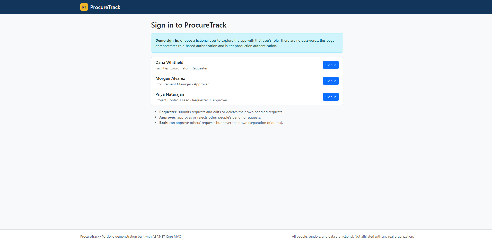
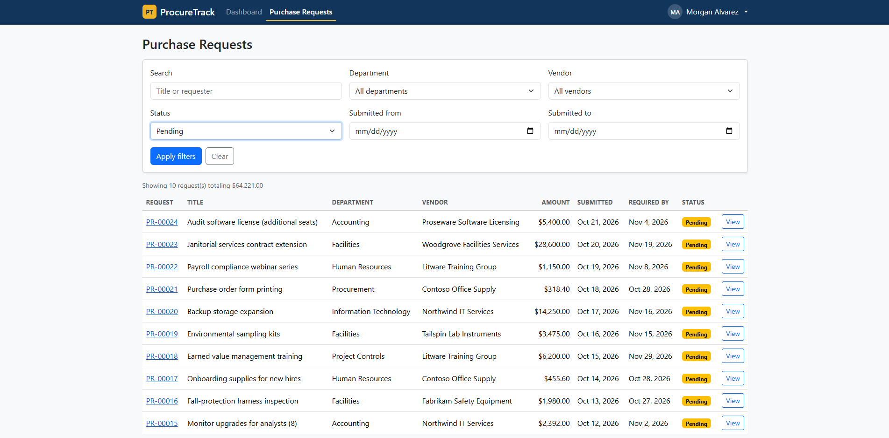
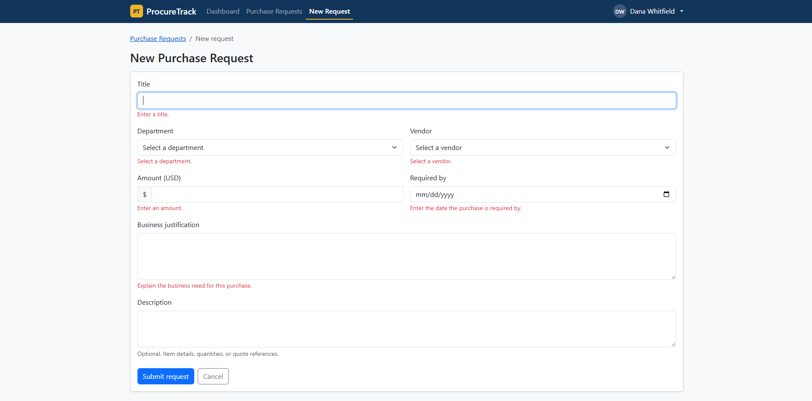
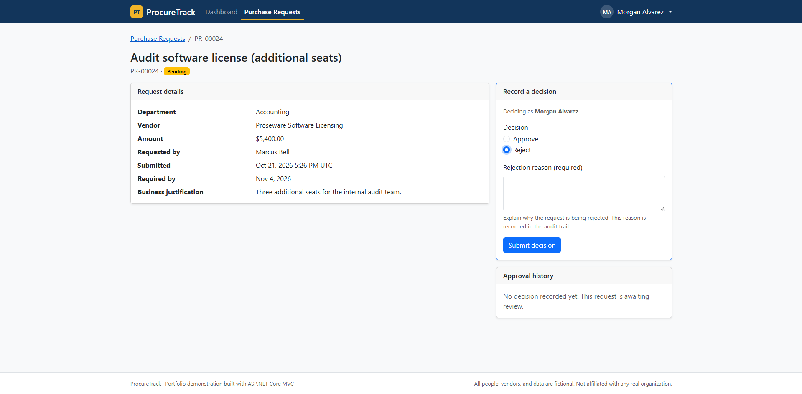
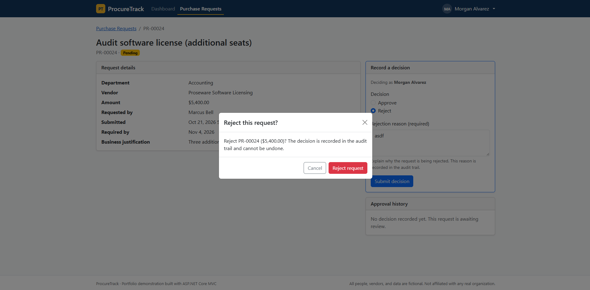

# ProcureTrack — User Guide

ProcureTrack is where employees submit purchase requests and approvers review them. This guide explains how to use it, by role.

> **About this demonstration:** you choose a fictional user on the sign-in page. In a production deployment, you would be signed in automatically with your work account.

## Contents

1. [Signing in](#1-signing-in)
2. [The dashboard](#2-the-dashboard)
3. [Finding requests](#3-finding-requests)
4. [Submitting a request (Requesters)](#4-submitting-a-request-requesters)
5. [Editing or deleting a request (Requesters)](#5-editing-or-deleting-a-request-requesters)
6. [Approving or rejecting (Approvers)](#6-approving-or-rejecting-approvers)
7. [Rules at a glance](#7-rules-at-a-glance)
8. [Messages you might see](#8-messages-you-might-see)
9. [Training exercises](#9-training-exercises)

## 1. Signing in

Open ProcureTrack and choose a user. Your name and role appear in the top-right corner; open that menu to see your roles or to **Sign out**.

| Role | What you can do |
|---|---|
| **Requester** | Submit purchase requests; edit or delete your own requests while they are pending |
| **Approver** | Approve or reject other people's pending requests |

Some people hold both roles. They can approve other people's requests, but never their own.

## 2. The dashboard

The dashboard is your starting point. It shows:

- **Total requests:** every request and its combined value
- **Pending approvals:** requests waiting for a decision, including how many have waited more than 7 days
- **Approved spending:** the total value of approved requests
- **Rejected requests:** each one has a recorded reason
- **Recently submitted:** the five newest requests
- **Approved spending by department**

Each card has a link that opens the request list already filtered. For example, **Review pending** shows only pending requests.

## 3. Finding requests

Open **Purchase Requests** in the top menu. Narrow the list with any combination of:

- **Search:** words in the title or the requester's name
- **Department**, **Vendor**, **Status**
- **Submitted from / to:** a date range

The list updates as you change filters. The page address also updates, so you can bookmark a filtered view or send the link to a colleague. Select **Clear** to remove all filters.

Click a request number or **View** to open its details, including its full approval history.

## 4. Submitting a request (Requesters)

1. Select **New Request** in the top menu (or on the dashboard).
2. Complete the form:
   - **Title:** a short description, such as "Laptop refresh for new analysts (4)"
   - **Department** and **Vendor:** only active vendors are listed
   - **Amount (USD):** between $0.01 and $1,000,000.00, with at most two decimal places
   - **Required by:** today or later
   - **Business justification:** why the purchase is needed; approvers rely on this
   - **Description:** optional item details, quantities, or quote references
3. Select **Submit request**.

If something is missing or invalid, a message appears under that field. Once submitted, the request is **Pending**, and you'll see its request number (for example, PR-00025). Your name and the submission time are recorded automatically.

## 5. Editing or deleting a request (Requesters)

While your request is **Pending**, open it and select:

- **Edit** to change any detail, then **Save changes**
- **Delete** to withdraw it; you'll be asked to confirm

After a request is approved or rejected, it is **closed**: it can't be edited or deleted, because it's part of the permanent record. If a rejected purchase is still needed, submit a new request that addresses the rejection reason.

You can only edit or delete **your own** requests.

## 6. Approving or rejecting (Approvers)

1. From the dashboard, select **Review pending**, or filter the list by **Status: Pending**.
2. Open a request and read the details and business justification.
3. In **Record a decision**, choose **Approve** or **Reject**.
   - **Approve:** notes are optional.
   - **Reject:** a **rejection reason is required**. The requester and auditors will see it.
4. Select **Submit decision**, check the summary in the confirmation box, then confirm. Select **Cancel** if you change your mind; nothing is saved.

The decision appears in the request's **Approval history** with your name, the date and time (UTC), and your notes.

You won't see the decision form on your own requests. Another approver must decide them.

## 7. Rules at a glance

| Rule | Why |
|---|---|
| New requests start as **Pending** | Every purchase is reviewed |
| Only **Pending** requests can be edited, deleted, approved, or rejected | Decisions are final and part of the record |
| You can only edit or delete **your own** requests | Requests stay accurate and accountable |
| Nobody can approve or reject **their own** request | Decisions are independent (separation of duties) |
| A **rejection reason is required** | Requesters know what to fix; auditors know why |
| Every decision is recorded permanently, with who, what, when, and why | Purchases can be audited |

## 8. Messages you might see

| Message | What it means | What to do |
|---|---|---|
| "Access denied" | Your role doesn't allow that action, or the request isn't yours | Use an account with the right role, or contact the requester |
| "… can no longer be edited" | The request has already been approved or rejected | Submit a new request if needed |
| "Someone else changed this request after you opened it" | Another person saved changes first | Reload the page, review the latest version, and try again |
| "… was changed by someone else before your decision was saved" | The request was edited while you were reviewing it | Review the current version before deciding |
| "Requesters cannot approve or reject their own requests" | Separation of duties | Ask another approver |
| "The request could not be processed" | The page may have been open too long | Go back, refresh the page, and try again |
| "Page not found" | The request doesn't exist or was deleted | Return to the request list |
| "Something went wrong" with a Reference ID | An unexpected error occurred | Report the Reference ID to support |

## 9. Training exercises

Each exercise takes about five minutes. Reset the demo data first if others have used it.

**Requester (sign in as Dana Whitfield)**
1. Submit a request with the form empty and read the messages.
2. Submit a complete request and note its request number.
3. Edit the amount and save.
4. Open a request submitted by someone else and confirm there's no Edit button.

**Approver (sign in as Morgan Alvarez)**
1. From the dashboard, open **Review pending**.
2. Reject one request. Try submitting without a reason first.
3. Approve another request and check its approval history.
4. Return to the dashboard and confirm the figures changed.

**Approver who also requests (sign in as Priya Natarajan)**
1. Open "Earned value management training," her own request, and read the note.
2. Open another employee's pending request and confirm you can decide it.