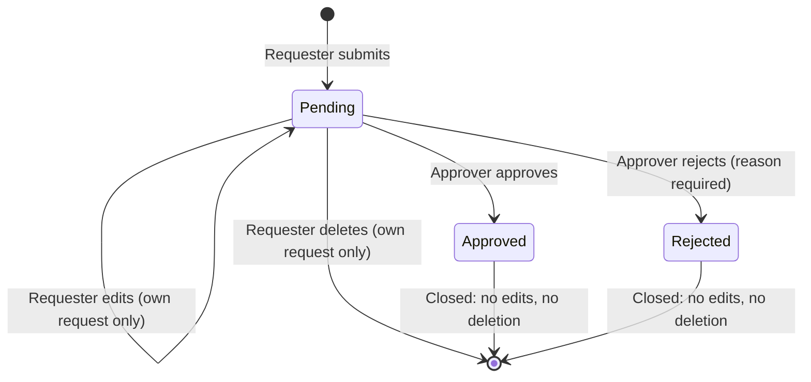

# ProcureTrack — User Stories and Storyboards

Stories were drafted from the project brief before development and refined as features were built. Each acceptance criterion is traced to the automated tests and manual QA checks that verify it (see the [test plan](test-plan.md)).

## Personas

| Persona | Role in ProcureTrack | Demo user |
|---|---|---|
| Employee (requester) | Submits and maintains their own purchase requests | Dana Whitfield |
| Approver | Approves or rejects other people's requests | Morgan Alvarez |
| Approver who also requests | Holds both roles; must never decide their own request | Priya Natarajan |
| Procurement analyst / reviewer | Searches, filters, and reviews spending | Any signed-in user |

## Request lifecycle

Only two status transitions exist: Pending → Approved and Pending → Rejected. Every other transition is refused on the server.

## Story summary

| ID | Story | Status |
|---|---|---|
| US-01 | Submit a purchase request | Implemented |
| US-02 | Edit or delete my pending request | Implemented |
| US-03 | Approve or reject a pending request | Implemented |
| US-04 | Separation of duties | Implemented |
| US-05 | Audit trail of decisions | Implemented |
| US-06 | Protection against conflicting changes | Implemented |
| US-07 | Find requests by department, vendor, status, and date | Implemented |
| US-08 | Dashboard of procurement activity | Implemented |
| US-09 | Role-based access | Implemented (demo sign-in) |
| US-10 | Parameterized procurement report | **Partially implemented** |

---

## US-01 — Submit a purchase request

**As an** employee, **I want to** submit a purchase request **so that** the purchase can be reviewed and approved.

| # | Acceptance criterion | Verified by |
|---|---|---|
| 1 | **Given** I am signed in as a Requester, **when** I submit a form with a title, department, active vendor, amount, required-by date, and business justification, **then** the request is saved as **Pending** and I see a confirmation with its request number. | QA-REQ-01 |
| 2 | **Given** I leave required fields empty, **when** I submit, **then** I see a message under each missing field without a page reload. | QA-REQ-02 |
| 3 | **Given** I enter an amount outside $0.01–$1,000,000.00, or with more than two decimal places, **then** the request is not saved and I see a clear message. | QA-REQ-03, QA-REQ-04 |
| 4 | **Given** I enter a required-by date in the past, **then** the request is not saved and I see the earliest allowed date. | QA-REQ-05 |
| 5 | The request records **me** as the requester and the **server time** as the submission date, regardless of any extra form fields sent. | `Create_IgnoresOverpostedStatusRequesterAndDate` |
| 6 | Text I enter is displayed as plain text, never interpreted as HTML or script. | QA-REQ-11 |

## US-02 — Edit or delete my pending request

**As an** employee, **I want to** correct or withdraw my request while it is still pending **so that** reviewers see accurate information.

| # | Acceptance criterion | Verified by |
|---|---|---|
| 1 | **Given** my request is Pending, **when** I edit and save it, **then** the changes are stored and I see a confirmation. | QA-REQ-06 |
| 2 | **Given** my request is Pending, **when** I delete it and confirm, **then** it is removed. | QA-REQ-09 |
| 3 | **Given** my request is Approved or Rejected, **when** I try to edit or delete it (including by typing the URL), **then** I am refused and told why. | QA-REQ-07, QA-REQ-08, `Owner_CannotEditApprovedRequest_IsRedirectedToDetails`, `CanEditAndCanDelete_OnlyAllowPendingRequests` |
| 4 | **Given** the request belongs to someone else, **when** I try to edit it, **then** access is denied. | QA-AUTH-04, `Requester_CannotEditSomeoneElsesRequest` |

## US-03 — Approve or reject a pending request

**As an** approver, **I want to** approve or reject pending requests **so that** purchasing decisions are made and recorded.

| # | Acceptance criterion | Verified by |
|---|---|---|
| 1 | **Given** a Pending request from someone else, **when** I choose Approve, confirm, and submit, **then** it becomes **Approved** and the decision appears in its history. | QA-DEC-06, `Approver_Approve_RecordsDecisionWithSignedInIdentity`, `Approve_PendingRequest_SetsApprovedAndRecordsAudit` |
| 2 | **Given** I choose Reject, **then** the notes field becomes "Rejection reason (required)", and I cannot submit without a reason. | QA-DEC-02, QA-DEC-04 |
| 3 | **Given** browser validation is bypassed (for example, JavaScript is disabled), **when** I reject without a reason, **then** the server refuses the rejection. | QA-DEC-05, `Reject_WithoutReason_Fails`, `Approver_RejectWithoutReason_ShowsErrorAndChangesNothing` |
| 4 | **Given** I am about to submit a decision, **then** I am asked to confirm it, and cancelling saves nothing. | QA-DEC-08 |
| 5 | **Given** a request is already Approved or Rejected, **then** no further decision can be recorded. | QA-DEC-10, `Approve_AlreadyDecidedRequest_Fails`, `Reject_AlreadyDecidedRequest_Fails` |
| 6 | **Given** I am signed in as a Requester only, **when** I send a decision to the server directly, **then** access is denied and nothing changes. | QA-AUTH-06, `Requester_CannotPostDecision_IsDeniedAndNothingChanges` |

## US-04 — Separation of duties

**As a** compliance stakeholder, **I want** nobody to approve or reject their own request **so that** purchasing decisions are independent.

| # | Acceptance criterion | Verified by |
|---|---|---|
| 1 | **Given** I hold the Approver role and open my own Pending request, **then** no decision form is shown, and a note explains that another approver must decide it. | QA-DEC-12 |
| 2 | **Given** I send a decision on my own request to the server directly, **then** it is refused and nothing changes. | `Approver_CannotDecideOwnRequest_SeparationOfDuties`, `Approve_ByRequester_FailsForSeparationOfDuties` |

## US-05 — Audit trail of decisions

**As a** compliance stakeholder, **I want** every decision recorded permanently **so that** purchasing activity can be audited.

| # | Acceptance criterion | Verified by |
|---|---|---|
| 1 | Every approval or rejection records the action, the approver (taken from the signed-in identity), the server timestamp (UTC), and any notes. | QA-DEC-14, `Approver_Approve_RecordsDecisionWithSignedInIdentity` |
| 2 | Decided requests and their audit records cannot be edited or deleted through the application. | QA-REQ-07, QA-REQ-08 |
| 3 | The database itself rejects a rejection record without a reason, and foreign keys prevent audit records from being cascade-deleted. | QA-DB-01 |

## US-06 — Protection against conflicting changes

**As an** approver, **I want** to be warned if a request changed after I opened it **so that** I never approve details I did not see.

| # | Acceptance criterion | Verified by |
|---|---|---|
| 1 | **Given** two people edit the same Pending request, **when** the second one saves, **then** their save is refused with an explanation instead of overwriting the first. | QA-REQ-10 |
| 2 | **Given** a request is edited after I opened it, **when** I submit a decision, **then** the decision is refused and the request stays Pending. | QA-DEC-11 |
| 3 | **Given** I double-click the confirm button, **then** only one decision is recorded. | QA-DEC-09 |

## US-07 — Find requests

**As a** procurement analyst, **I want to** filter requests by department, vendor, status, and date **so that** I can review spending.

| # | Acceptance criterion | Verified by |
|---|---|---|
| 1 | **Given** I change any filter, **then** the results update without reloading the page, and the URL reflects the filters. | QA-FLT-01, QA-FLT-03 |
| 2 | **Given** I type in the search box, **then** results update after I pause typing, matching the title or requester. | QA-FLT-02 |
| 3 | **Given** an end date earlier than the start date, **then** I see an error and no search runs. | QA-FLT-04 |
| 4 | **Given** no requests match, **then** I see a clear empty state with a way to clear the filters. | QA-FLT-08 |
| 5 | **Given** JavaScript is unavailable, **then** filtering still works with full page reloads. | QA-FLT-07 |

## US-08 — Dashboard

**As a** manager, **I want** a dashboard of current procurement activity **so that** I can see workload and spending at a glance.

| # | Acceptance criterion | Verified by |
|---|---|---|
| 1 | The dashboard shows total requests, pending approvals, approved spending, and rejected requests, calculated from the database. | QA-DASH-01 |
| 2 | Each figure links to the request list filtered to match it. | QA-DASH-02 |
| 3 | After a decision is recorded, the dashboard figures reflect it immediately. | QA-DASH-03 |

## US-09 — Role-based access

**As a** system owner, **I want** users to see and do only what their role allows **so that** the workflow cannot be bypassed.

| # | Acceptance criterion | Verified by |
|---|---|---|
| 1 | Signed-out visitors are sent to the sign-in page for every application page. | QA-AUTH-01, `Anonymous_Dashboard_RedirectsToSignIn` |
| 2 | Only Requesters can create requests; only Approvers can record decisions. | QA-AUTH-05, QA-AUTH-06, `Approver_CannotOpenCreatePage`, `Requester_CannotPostDecision_IsDeniedAndNothingChanges` |
| 3 | Every state-changing form submission requires a valid antiforgery token. | QA-DEC-13, QA-REQ-12, `PostWithoutAntiforgeryToken_IsRejectedWith400` |

**Note:** sign-in uses fictional demo users without passwords. It demonstrates role-based authorization and is not production authentication (see the README).

## US-10 — Parameterized procurement report

**As a** reviewer, **I want** a parameterized report **so that** I can examine procurement activity for a particular department or period.

| # | Acceptance criterion | Status | Verified by |
|---|---|---|---|
| 1 | Report data can be filtered by a date range and, optionally, one department. | **Met**: stored procedure `usp_ProcurementReport` | QA-RPT-01 |
| 2 | An invalid date range produces a clear error. | **Met** | QA-RPT-01 |
| 3 | The report groups requests by department with subtotals and a grand total, in a printable layout. | **Not met**: SSRS report not delivered (see README, Reporting) | — |

---

## Storyboards

### SB-1 — Employee submits a request (Dana Whitfield)

| Frame | Screen | User action | System response |
|---|---|---|---|
| 1 | Sign-in ([screenshot](screenshots/sign-in.png)) | Chooses **Dana Whitfield (Requester)** | Dashboard opens; the nav shows **New Request** |
| 2 | New Request form | Submits the form with fields missing | Messages appear under each missing field ([screenshot](screenshots/create-validation.png)) |
| 3 | New Request form | Completes the fields and submits | Details page: "PR-000xx was submitted for review", status **Pending** |
| 4 | Request details | Clicks **Edit**, changes the amount, saves | "PR-000xx was updated" |

### SB-2 — Approver reviews and decides (Morgan Alvarez)

| Frame | Screen | User action | System response |
|---|---|---|---|
| 1 | Dashboard ([screenshot](screenshots/dashboard.png)) | Clicks **Review pending** on the Pending approvals card | Request list filtered to Pending ([screenshot](screenshots/request-list.png)) |
| 2 | Request list | Changes the department filter | Table updates in place; the URL updates |
| 3 | Request details | Selects **Reject** | Field relabels to "Rejection reason (required)" ([screenshot](screenshots/request-details-decision.png)) |
| 4 | Request details | Enters a reason, clicks **Submit decision** | Confirmation dialog summarizes the decision ([screenshot](screenshots/decision-confirm.png)) |
| 5 | Confirmation dialog | Clicks **Reject request** | "PR-000xx was rejected"; the request is closed to editing; the history shows the reason, approver, and time ([screenshot](screenshots/approval-history.png)) |

### SB-3 — Separation of duties (Priya Natarajan)

| Frame | Screen | User action | System response |
|---|---|---|---|
| 1 | Request list | Opens another employee's pending request | Decision form shown: "Deciding as Priya Natarajan" |
| 2 | Request list | Opens **her own** pending request | No decision form; a note explains that another approver must decide it ([screenshot](screenshots/separation-of-duties.png)) |

### SB-4 — Access control (Dana Whitfield)

| Frame | Screen | User action | System response |
|---|---|---|---|
| 1 | Request details (someone else's request) | Looks for Edit or Delete | No Edit, Delete, or decision controls are shown |
| 2 | Browser address bar | Types `/PurchaseRequests/Edit/{id}` for that request | **Access denied** page; nothing changes |